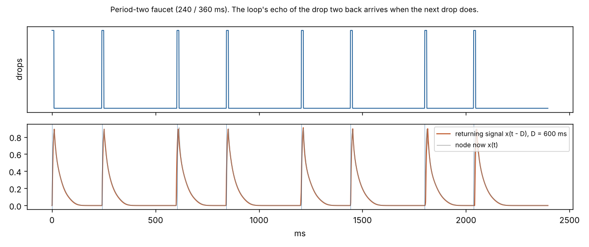
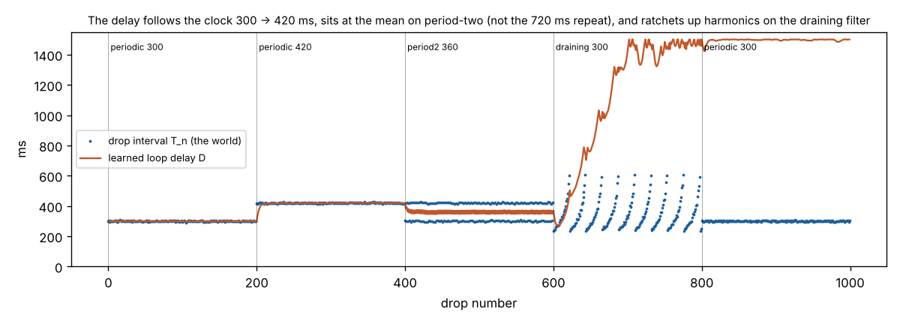

# Pisara

*Pisara* is Finnish for a drop. The name is from the last page of Robert Shaw's *The Dripping Faucet as a Model Chaotic System* (1984): when the falling drop is perceived, it falls in the brain as well.

**The question.** Can one nonlinear unit whose own output comes back to it after a delay (a "tuft loop") forecast the next drop of a faucet without writing down any equation? And can the unit learn the delay itself, the way myelin tunes conduction time?

This came out of a morning discussion (November 23, 2026) between Antti, Sol (ChatGPT), Neon (Gemini) and Claude (Opus 5.5). It started from coffee grounds dripping slower and slower, and ran through:
- neurons predicting each other;
- Takens delay embedding;
- Shaw's faucet;
- anticipating synchronization (Voss 2000);
- single-node delay reservoirs with "virtual nodes" (Appeltant et al. 2011).

Claude built this repo. Sol is building the five-arm baseline comparison separately.

## The machine

```
dx/dt = ( -x + tanh( beta * x(t - D) + gamma * s(t) ) ) / theta
```

- `s(t)`: the drops, as 10 ms pulses on a 1 ms clock.
- `x(t - D)`: the node's own past coming back, the "tuft". Default `beta = 0.9` (the echo fades over a few rounds), `theta = 5 ms`.
- `beta = 0` cuts the loop. The node is then a plain leaky unit, and its last W ms form a delay window: an explicit Takens-style line of the filtered input.

Three ways to read the machine:

- **Readout**: a ridge regression from 50 samples of the delay line (the virtual nodes), taken when drop *n* starts, to the next interval.
- **Echo forecast (no readout at all)**: after drop *n*, the next drop is predicted for the moment the *returning* signal `x(t - D)` rises. This only reads what was already in the loop when drop *n*'s pulse ended; a unit test checks it cannot see the future.
- **Learned delay (the "myelin" rule)**: when a drop arrives, find the steepest rise in the returning signal within ±150 ms of `t - D`, and move `D` 30% of the way toward making that rise coincide with the drop. There is no interval error and no readout, only coincidence.

## The worlds

Following Shaw (`pisara/world.py`):

| world | what it is | stored information I(T_{n+1}; T_n) |
|---|---|---:|
| periodic | water clock, 300 ms, 1% jitter | 0.00 bits |
| period2 | 240 / 360 ms alternating | 0.82 bits |
| chaotic | Shaw's Fig. 4 map, x' = 3.6 x (1 − x) + 0.02 noise, T = 200–400 ms | 2.27 bits |
| draining | coffee filter, rate ∝ √level, refilled when slow | 2.39 bits |
| shuffled | chaotic intervals, order destroyed | 0.01 bits |
| iid | uniform 200–400 ms | 0.00 bits |

The stored information is Shaw's measure (15 equiprobable bins, shuffle bias subtracted). Means over seeds 11–13.

## Gate 1: forecasting the next drop

Three frozen seeds (11, 12, 13), 1500 drops each. Split: first 50% train, next 20% validation (picks D or W), last 30% test.

NMSE means the error divided by the variance of the next interval. 1.0 is no better than always guessing the mean.

| world | clock | linear history | quadratic history | no-loop window | tuft loop |
|---|---:|---:|---:|---:|---:|
| periodic | 1.00 | 1.00–1.02 | 1.00–1.02 | 1.00–1.01 | 0.98–1.08 |
| period2 | 1.00 | 0.003 | 0.003 | **0.002–0.003** | 0.003–0.004 |
| chaotic | 1.00 | 0.25–0.35 | 0.031–0.049 | **0.012, 0.012, 0.079** | 0.07–0.14 |
| draining | 1.00 | 0.54–0.55 | 0.27–0.28 | **0.18–0.20** | 0.28–0.37 |
| shuffled | 1.00 | 1.00–1.02 | 1.02–1.03 | 1.08–1.12 | 1.06–1.10 |
| iid | 1.00 | 1.00–1.03 | 1.01–1.04 | 1.00–1.04 | 0.99–1.12 |

Echo forecast with no readout, mean absolute timing error in ms (D chosen on validation):

| world | clock | quadratic history | echo |
|---|---:|---:|---:|
| periodic | 2.3–2.4 | 2.3–2.4 | 2.8–2.9 (D = 300) |
| period2 | 60 | 2.5–2.7 | **3.7–4.0 (D = 600 = 240 + 360)** |
| chaotic | 38 | 6.1–6.8 | 50–80 (fails) |
| draining | 80–81 | 32.5–32.7 | 232–235 (fails) |



## Gate 2: learning the delay

Seeds 21, 22, 23.

**A. Where does the delay settle?** Starting from 150 to 900 ms, 600 drops:

- periodic: settles at the period or its multiples (≈ 300, 600, 900).
- period2: two basins. ≈ 288 (the mean interval; echo error ≈ 37 ms) or ≈ 597 (the full 240 + 360 repeat; echo error 3.2–3.5 ms, as good as the best fixed delay). Which one it takes depends on where it starts.
- chaotic: learned echo error 36–57 ms. That is better than the best single fixed delay (54–75 ms) but worse than a running-mean clock (37–40 ms).
- draining: every start ratchets up to 1318–1407 ms, a multiple of recent intervals. Echo error ≈ 250 ms, worse than the best fixed delay (≈ 210) and far worse than the clock (≈ 88).
- shuffled: nothing to find. The learned echo is worse than the clock, as it should be.

**B. Switching world.** clock 300 → clock 420 → period-two 300/420 → draining → clock 300, with the delay starting at 300. Mean absolute error in ms, seeds 21/22/23:

| segment | learned delay | best single fixed delay (D = 1200, hindsight) | running clock |
|---|---|---|---|
| clock 300 | 2.4 / 2.6 / 2.8 | 4.5 / 6.4 / 7.0 | 2.1–2.6 |
| clock 420 | **2.3 / 2.7 / 2.7** (delay ends at 417–420) | 241 / 241 / 243 | 2.2–2.5 |
| period-two | 37 (sits at the mean, ≈ 347) | 240–244 | 60 |
| draining | 239–252 (ratchets to ≈ 1460) | 257–260 | 88–89 |
| clock 300 again | 6.0–9.3 (stuck at the 1500 cap) | 4.5–6.7 | 2.3–2.5 |



**C. Omission.** In period-two, 10% of the drops were removed. The loop with a learned delay produced a rise at the time of **every** missing drop, with onset error 3.8–5.3 ms. A no-loop unit produced none. That is silence becoming a signal: the echo keeps coming when the world stops.

## Gate 3: can competing loops grow their own Takens embedding?

**Setup.** Six loops learn their delays on the first half of each run. Without competition they all collapse onto one delay. With soft repulsion between delays they pack into a tight cluster. So the version tested gives each loop its own range: 150–350, 350–550, …, 1150–1350 ms. Think of axons of different length classes, with myelin tuning within each class.

**Forecaster.** The learned delays become Takens delays for one slow observable y(t), the drops through a 100 ms leak. The next interval is forecast by nearest-neighbour analogues (k = 10) in that embedding.

**Opposite rule, added for comparison.** One loop moves its delay until what *returns* is **uncorrelated** with what arrives now: gradient descent on c², with c a running correlation. This is the anti-Hebbian version of the myelin rule. Its delay τ is used as τ, 2τ, …, 6τ.

**Fresh seeds 31, 32, 33**, not looked at before the run. 2000 drops each; test is the second half. NMSE per seed:

| world | coincidence loops | decorrelating loop | autocorrelation zero (offline) | Fraser–Swinney | range centres | random | quadratic history |
|---|---|---|---|---|---|---|---|
| chaotic | 0.025 / 0.026 / 0.050 | **0.013 / 0.011 / 0.014** | 0.013 / 0.011 / 0.014 | 0.013 / 0.012 / 0.015 | 0.028 / 0.023 / 0.040 | 0.026 / 0.022 / 0.040 | 0.033 / 0.029 / 0.046 |
| draining | 0.024 / 0.013 / 0.012 | 0.011 / 0.011 / 0.014 | 0.012 / 0.012 / 0.014 | 0.012 / 0.012 / 0.014 | 0.015 / 0.058 / 0.037 | 0.010 / 0.011 / 0.013 | 0.286 / 0.277 / 0.281 |
| period2 | 0.003 | 0.003 | 0.003 | 0.003 | 0.003 | 0.003 | 0.003 |
| periodic | 1.09–1.10 | 1.09–1.10 | 1.08–1.10 | 1.09–1.10 | 1.05–1.10 | 1.06–1.09 | 1.00 |
| shuffled | 1.07–1.13 | 1.07–1.12 | 1.07–1.12 | 1.11–1.13 | 1.07–1.14 | 1.06–1.15 | 1.02–1.03 |

The delay learned online by the decorrelating loop vs the autocorrelation zero computed offline, for every world and seed:
- periodic: 61 vs 62 ms
- period-two: 66 vs 67 ms
- chaotic: 69 vs 70 ms
- draining: 79 vs 80 ms
- shuffled: 69–70 vs 70 ms

**What this says.**
- The coincidence loops spread across harmonics: ≈ 300, 450, 600, 900, 1050, 1200 ms on the clock. But those delays all sample the world at the same phase, just after a drop. They are the most *redundant* delays possible. On the chaotic faucet they embed worse than evenly spaced or even random delays, and 2–3.5× worse than the decorrelated ones.
- The opposite rule, one local online loop, finds the classic embedding delay to within 1–2 ms. Its embedding ties the hand-computed autocorrelation-zero and Fraser–Swinney choices, and beats regression on the last 4 intervals 2.5–3× on the chaotic faucet.
- **The hypothesis this leaves.** Timing plasticity may come in two opposite kinds for two jobs:
  - *Hebbian / coincidence* delays for being in step (anticipation, the echo, the omission response);
  - *anti-Hebbian / decorrelating* delays for representing the world (embedding).

  This is the morning's first idea, Barlow and Földiák's anti-Hebbian decorrelation, reappearing in time instead of space. It is a hypothesis from a model, not a claim about cortex.

**Caveats.**
- The decorrelating delay learned on the **shuffled** world is the same, and works as well. The rule learns the world's *timescale* (set by the leak and the typical interval), not its order. The order is read by the nearest-neighbour forecaster.
- The multiples 1…6 of τ were given by hand, as in classic embedding. Only τ itself is learned.
- Draining does not discriminate: random long delays tie the best.
- The Fraser–Swinney mutual-information curve is jagged, and its "first minimum" of 30 ms is probably a binning artifact. It still embeds about as well.
- Periodic and shuffled: nothing beats the clock, as expected. Nearest neighbours overfit to 1.05–1.15.

## Gate 4: one neuron, both rules

**Setup.** One unit has two loops on the same drops:
- an **in-step** loop (coincidence delay; its echo forecasts the next drop);
- a **describing** loop (decorrelating delay τ). The slow trace at t, t − τ, …, t − 6τ is the unit's state, and the next interval is forecast by nearest analogues among states it has already lived through.

**Two pairings:**
- **gate**: trust whichever loop has been right lately;
- **feature**: the echo's expectation added as one more coordinate of the state.

**Run.** Fully online, one pass, on a switching world: clock 300 → clock 420 → period-two → chaotic → draining → clock 300. Fresh seeds 41–43. One smoke run on seed 9 came before the frozen run, and the post-switch metric and the feature pairing were added after it. Mean absolute error in ms:

| | running clock | in-step alone | describing alone | both (gate) | both (feature) |
|---|---:|---:|---:|---:|---:|
| overall, seeds 41/42/43 | 35.1 / 35.0 / 34.7 | 63.1 / 66.3 / 66.7 | **14.4 / 14.4 / 14.4** | 14.6 / 14.2 / 14.3 | 15.0 / 14.8 / 15.2 |
| first 15 drops after each switch | 56.5 / 56.4 / 55.8 | 159 / 165 / 167 | **52.3 / 52.9 / 54.6** | 56.3 / 52.9 / 54.6 | 57.4 / 57.5 / 58.0 |

**Kill condition met: the pairing adds nothing to forecasting.**
- The gate ties the describing loop overall (±0.2 ms) and never beats it after switches.
- The feature pairing is slightly worse everywhere except draining (42 vs 45 ms).

The in-step loop is held back by the Gate 2 failures. On period-two it sits at the mean (≈ 348 ms, 51 ms error). On draining it ratchets to ≈ 1450 ms and stays there.

**What did work.** The describing loop alone is local and online, with one learned delay and memory of past states. It beats the running clock 2.4× overall, and 3.6–5.8× on period-two, chaotic and draining.

So in this model, interval forecasting is the describing loop's job. The in-step loop's remaining value is what Gate 2C showed: timing, such as rising on schedule when a drop is missing. Forecasting the size of the next interval did not test that.

## Ledger (Gates 1–2)

**Verified**
- Takens-style memory works without any equation. A plain leaky node read as a window of its last W ms beat explicit regression on past intervals:
  - chaotic faucet: 0.012 NMSE in 2 of 3 seeds, vs 0.031–0.049 for quadratic regression on the last 4 intervals;
  - draining filter: 0.18–0.20 vs 0.27–0.28.

  The timing of the last drops becomes a *place* in the window, and a linear readout of the place handles the nonlinear map.
- With no readout at all, the loop's own echo forecasts the period-two faucet to within 3.7–4.0 ms (clock: 60 ms). It does this when D equals the full 600 ms repeat: the echo of the drop two back arrives with the next drop.
- The coincidence rule learns the clock period from anywhere within about ±150 ms of it. It follows a jump from 300 to 420 ms within a few drops, where any single fixed delay fails (240 ms error).
- Omitted drops produce on-time rises (Part C).
- Controls: on shuffled and iid intervals, no method beats the clock. The readouts overfit slightly, to NMSE 1.06–1.12.

**Failed or open**
- **The recirculation did not help the readout.** The tuft loop scored worse than the no-loop window on chaotic and draining, and tied on period-two. Its echoes clutter the window. Its value here is only the readout-free echo and the omission response.
- **Harmonics.** The learned delay cannot tell T from 2T or 3T, and on period-two it often settles at the mean (37 ms error) instead of the 600 ms repeat. On the draining filter it climbs harmonics and never comes back, even when the world returns to a 300 ms clock. Kill condition for this world: met.
- **The echo cannot follow chaos** (50–80 ms, worse than the clock). A single fixed delay is a clock with one period. It can carry period-two but not a map.
- The omission control is weak. A unit with no loop cannot rise without input at all, so it fails by construction. The stronger control, a more excitable unit with a short adaptation current, is not done yet.
- Not blind. The settings (echo threshold 0.25, ±150 ms window, η = 0.3, β = 0.9, θ = 5 ms) were chosen while looking at traces from seeds 0–3 and **seed 11**, which is also the first Gate 1 seed. Seed 21 was used for one trial run of Gate 2 before the final run, with no settings changed after it. Fresh seeds are the next honest step.

## Next

- **Luotain2 audit** of the virtual-node sheet (node × cycle as a 2D field), with Sol's control: the same audit with the node order scrambled. A law that survives scrambling came from the arrangement, not the dynamics.
- **Delay-jitter lesion**: make conduction timing unreliable and measure how fast the anticipation collapses. This is a model property, not a model of disease.
- **Test the in-step loop on its own job**: an omission and surprise task (detect a missing or early drop as fast as possible), where the describing loop has no natural advantage. Only there can the pair earn its keep.
- **Fix the in-step loop's basins** (mean basin on period-two, harmonic ratchet on draining) before pairing again.
- **Learn the multiples too**: a chain where each loop decorrelates from the one before, instead of hand-given 1…6 τ.
- **Matched capacity** (Dambre et al. 2012), so the loop and the window are compared at the same memory budget.
- **A knobs page**: drag the flow and the delay, and watch the loop lock and slip.

## Run it

```
pip install -r requirements.txt
python -m pytest -q tests          # 5 tests, < 2 s
python scripts/run_gate1.py        # -> results/gate1.json   (~25 s with numba)
python scripts/run_gate2.py        # -> results/gate2.json
python scripts/run_gate3.py        # -> results/gate3.json   (~20 s)
python scripts/run_gate4.py        # -> results/gate4.json   (~5 s)
python scripts/make_figures.py     # -> fig/
```

numba is optional. Without it the simulation runs in plain Python, much more slowly.

## References

- R. Shaw, *The Dripping Faucet as a Model Chaotic System*, Aerial Press, 1984.
- H. U. Voss, Anticipating chaotic synchronization, Phys. Rev. E 61, 5115 (2000).
- L. Appeltant et al., Information processing using a single dynamical node as complex system, Nat. Commun. 2, 468 (2011).
- F. Takens, Detecting strange attractors in turbulence (1981).
- S. Pajevic, P. J. Basser, R. D. Fields, Role of myelin plasticity in oscillations and synchrony of neuronal activity, Neuroscience (2014).
- J. Dambre et al., Information processing capacity of dynamical systems, Sci. Rep. 2, 514 (2012).
